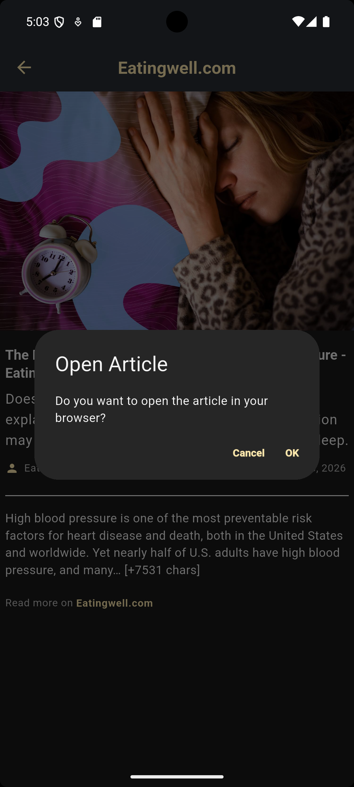

# NewsCloud 📰


NewsCloud is a Flutter news reader that loads current articles from the
[News API](https://newsapi.org/). It provides a clean, responsive reading
experience with category browsing, article search, detailed article views,
theme preferences, and clear loading, empty, and error states.

## Screenshots

<table>
  <tr>
    <td></td>
    <td></td>
    <td></td>
    <td></td>
    <td></td>
    <td></td>
    <td></td>
  </tr>
</table>

## Features

### Discover news

- View the latest top headlines on the home screen.
- Browse articles by:
  - Business
  - Entertainment
  - Health
  - Science
  - Technology
  - Sports
  - General
- Tap any news card to open its full article view.
- Pull down to refresh the home feed or a category feed.

### Search

- Open search from the home screen menu.
- Search articles as the query changes.
- Clear the search field to return to the general headlines.
- See a dedicated empty state when no matching articles are found.

### Article details

Each article can display:

- A cached cover image
- Title
- Description
- Full available content
- Source name
- Publication date formatted for readability
- A link to open the original article in the external browser

Missing images, dates, content, and source links are handled gracefully.

### Appearance and UX

- Light and dark themes.
- Theme preference persisted locally with `shared_preferences`.
- System theme used as the initial default when no preference has been saved.
- Material 3 design system.
- Custom Roboto typography and themed colors.
- Shimmer placeholders while remote images load.
- Loading shimmer while article requests are in progress.
- Helpful empty states for feeds with no available articles.
- User-visible error messages for network, timeout, server, and unexpected
  failures.

## Screens and navigation

The app contains three main flows:

1. **Home** — general headlines, category shortcuts, search, theme controls,
   refresh, and article cards.
2. **Category** — articles for a selected category with refresh support.
3. **Article details** — complete article information and an external
   "Read more" link.

Navigation is handled through named routes and a route generator. Each
category screen receives its own `CategoryCubit`, while the home screen uses
`NewsCubit`.

## Architecture

The project follows a clean, layered architecture:

```text
lib/
├── core/
│   ├── config/                 # API and theme configuration
│   ├── constants.dart          # Categories and shared constants
│   ├── errors/                 # Exceptions, failures, and error mapping
│   ├── routes/                 # Named routes and route generation
│   └── services/               # News API service
│
└── features/
    ├── data_layer/
    │   ├── models/             # API response models
    │   └── repositories/       # Repository implementations
    │
    ├── domain_layer/
    │   ├── entities/           # UI-independent business entities
    │   ├── repositories/       # Repository contracts
    │   └── usecases/           # Get headlines and search articles
    │
    └── presentation_layer/
        ├── cubit/              # News, category, and theme state
        ├── views/              # App screens
        └── widgets/            # Reusable UI components
```

### Data flow

```text
NewsService
    ↓
NewsRepositoryImpl
    ↓
Use case
    ↓
NewsCubit / CategoryCubit
    ↓
NewsState
    ↓
Flutter widgets
```

`Dio` exceptions are converted into application exceptions, then mapped to
typed failures such as `NetworkFailure`, `TimeoutFailure`, and
`ServerFailure`. Cubits expose those failures through `NewsError`, allowing
the UI to display the actual user-friendly message.

## Technologies

- [Flutter](https://flutter.dev/)
- [Dart](https://dart.dev/)
- [Flutter Bloc](https://pub.dev/packages/flutter_bloc) and Cubit
- [Dio](https://pub.dev/packages/dio) for HTTP requests
- [Equatable](https://pub.dev/packages/equatable) for value equality
- [Flutter Dotenv](https://pub.dev/packages/flutter_dotenv) for local API
  configuration
- [Cached Network Image](https://pub.dev/packages/cached_network_image)
- [Shimmer](https://pub.dev/packages/shimmer)
- [Intl](https://pub.dev/packages/intl) for date formatting
- [Shared Preferences](https://pub.dev/packages/shared_preferences) for
  theme persistence
- [URL Launcher](https://pub.dev/packages/url_launcher) for external links
- [Bloc Test](https://pub.dev/packages/bloc_test) for Cubit tests

## API configuration

Create a `.env` file in the project root:

```env
API_URL=https://newsapi.org/v2
API_KEY=your_newsapi_org_key_here
```

Get an API key from
[newsapi.org/register](https://newsapi.org/register).

The app reads `API_URL` and `API_KEY` at startup through `flutter_dotenv`.
The `.env` file is ignored by Git, so never commit your real key. An API key
bundled into a distributed mobile application can still be extracted from
the application package. For a production release, proxy API requests
through a backend instead of shipping the key in the client.

## Getting started

### Requirements

- Flutter SDK
- Dart SDK compatible with the project constraint in `pubspec.yaml`
- A News API key

### Installation

```bash
git clone https://github.com/kawtharrashid/news_cloud.git
cd news_cloud
flutter pub get
```

Create the `.env` file described above, then run:

```bash
flutter run
```

## Testing

Run the test suite with:

```bash
flutter test
```

The tests do not make real network requests. They use a fake repository and
cover:

- Article JSON parsing
- Missing and invalid publication dates
- Default article title behavior
- Successful headline loading
- Search query forwarding
- Failure-to-`NewsError` conversion
- Unexpected exception handling
- Loading and loaded state transitions

Run static analysis with:

```bash
flutter analyze
```

## Continuous integration

Every push and pull request to `main` runs:

- `flutter analyze`
- `flutter test`

The workflow is defined in
[`.github/workflows/ci.yml`](.github/workflows/ci.yml).

## Project goals

NewsCloud was built as a Flutter portfolio project to practice:

- Clean separation of responsibilities
- Repository and use-case patterns
- Cubit state management
- REST API integration
- Typed exception and failure handling
- Reusable and responsive Flutter widgets
- Named navigation and route generation
- Local preference persistence
- Automated testing and CI

## Future improvements

- Pagination or infinite scrolling
- Favorites and bookmarks
- Offline article caching
- More comprehensive widget and integration tests
- Accessibility improvements
- A backend proxy for production API key protection

## Author

**Kawthar Rashid** — Flutter Developer

- GitHub: [github.com/kawtharrashid](https://github.com/kawtharrashid)
- LinkedIn:
  [linkedin.com/in/kawthar-rashid-811418437](https://www.linkedin.com/in/kawthar-rashid-811418437/)
